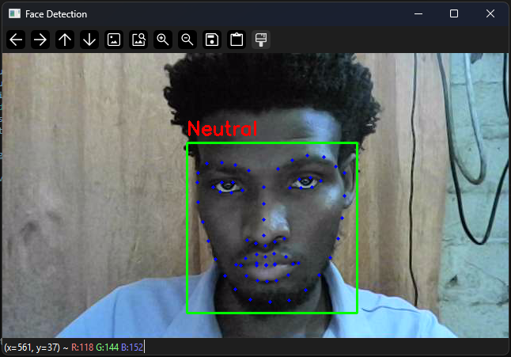
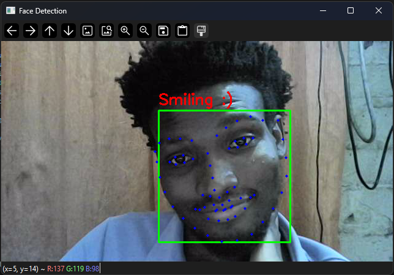

# Real-Time Face Detection

A C++ desktop application that captures video from your camera, detects human faces in real time using Dlib's frontal face detector, identifies 68 facial landmarks, and computes a smile ratio to determine whether the person is smiling.

Built with **OpenCV** (video capture and rendering) and **Dlib** (face detection and landmark prediction).

## Demo





## Features

- Real-time face detection via Dlib's HOG-based frontal face detector
- 68-point facial landmark detection
- Smile detection using a geometric mouth width/height ratio
- Facial landmark visualization (green box, blue points, red status text)
- Press `q` to quit

## Requirements

- **CMake** 3.16 or newer
- **C++17** compiler (MinGW-w64 GCC 9+, MSVC 2019+, or Clang 10+)
- **OpenCV** 4.x
- **Dlib** 19.20 or newer
- **Landmark model file** `shape_predictor_68_face_landmarks.dat` (see below)

## Get the landmark model

The 68-point landmark model is **not included in the repository** (it is ~99 MB). Download it once and place it in the project root:

```bat
curl.exe -L http://dlib.net/files/shape_predictor_68_face_landmarks.dat.bz2 -o shape_predictor_68_face_landmarks.dat.bz2
tar.exe -xjf shape_predictor_68_face_landmarks.dat.bz2
```

On Linux / macOS:

```bash
curl -L http://dlib.net/files/shape_predictor_68_face_landmarks.dat.bz2 -o shape_predictor_68_face_landmarks.dat.bz2
bunzip2 shape_predictor_68_face_landmarks.dat.bz2
```

Without `curl`/`tar`, download both the `.dat.bz2` and 7-Zip from the official sources and extract manually. The CMake build copies the `.dat` file next to the executable automatically.

## Build

### Windows (MinGW)

Point CMake at your Dlib config folder if it is not in a standard location:

```bat
cmake -G "MinGW Makefiles" -S . -B build -DCMAKE_BUILD_TYPE=Release -Ddlib_DIR="C:/path/to/dlib/cmake"
cmake --build build -j
```

### Linux / macOS

```bash
cmake -S . -B build -DCMAKE_BUILD_TYPE=Release
cmake --build build -j
```

The executable is produced at `build/FaceDetect.exe` (Windows) or `build/FaceDetect` (Linux/macOS).

## Run

```bat
build\FaceDetect.exe
```

```bash
./build/FaceDetect
```

A window opens showing the camera feed:

- **Green rectangle** — detected face
- **Blue points** — 68 facial landmarks
- **Red text above the face** — "Smiling :)" or "Neutral"
- Press **q** to quit

## Smile detection

The smile classifier compares mouth width to mouth height using four of Dlib's 68 landmark points:

| Landmark | Point |
|---|---|
| 48 | Left mouth corner |
| 54 | Right mouth corner |
| 51 | Top of upper lip |
| 57 | Bottom of lower lip |

```
mouthWidth  = norm(point54 - point48)
mouthHeight = norm(point57 - point51)
smileRatio  = mouthWidth / mouthHeight
```

A smiling mouth is wider relative to its height than a neutral mouth. The ratio is smoothed over the last 5 frames per face, then thresholded.

### Threshold tuning

The default threshold is **3.15**. This value is **camera- and lighting-dependent**:

- Neutral: roughly 2.0 – 3.0
- Smiling: roughly 3.1 – 4.0

If the classifier is too eager or too sluggish on your setup, adjust the `3.15` constant in `detectSmile()` in `main.cpp`.

## Known limitations

- The HOG-based frontal face detector works best on **frontal faces**. Profile views and extreme angles are often missed.
- Detection quality drops in **low light** and for **small or distant faces**.
- The smile threshold is calibrated for typical webcam framing — see **Threshold tuning** above.
- The program assumes the camera is available at **device index 0**.

## Project structure

```
face-detection/
├── CMakeLists.txt
├── main.cpp
├── README.md
├── LICENSE
├── images/
│   ├── neutral.png
│   └── smile.png
└── shape_predictor_68_face_landmarks.dat   (downloaded, not tracked)
```

## License

MIT License — see [LICENSE](LICENSE).

OpenCV is licensed under the BSD 3-Clause License; Dlib is licensed under the Boost Software License. If you redistribute their binaries or source, include the respective license notices.

## Author

Radithole Maripa